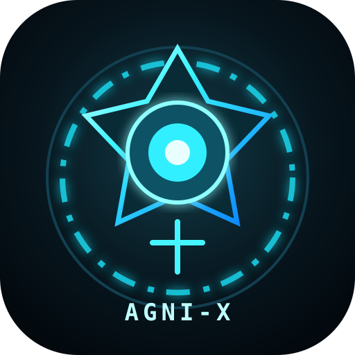

<div align="center">
  
  <h1>AGNI-X</h1>
  <p><strong>A voice-enabled personal assistant for Windows desktop workflows.</strong></p>
  <p>Voice and typed commands · productivity notes and tasks · optional AI chat · Windows app control</p>
</div>

AGNI-X is a Python desktop assistant built with CustomTkinter. It brings common laptop actions and lightweight personal productivity tools into one interface, with a local-response mode when an OpenAI API key is not configured.

## What it can do

- Accept typed commands and voice commands (wake word: `AGNI`).
- Open and search websites, and discover or launch installed Windows apps.
- Create notes and tasks, save contacts, and remember basic profile preferences in local JSON files.
- Offer optional OpenAI chat using an API key supplied through an environment variable.
- Provide speech output, a live clock, weather, and an animated dashboard.
- Use optional Windows UI automation to focus windows, type text, press keys, and click buttons.

## Quick start

**Requirements:** Windows 10/11, Python 3.10 or newer, and a working microphone for voice input.

1. Open PowerShell in this folder.
2. Create and activate a virtual environment:

   ```powershell
   py -3 -m venv .venv
   .\.venv\Scripts\Activate.ps1
   ```

3. Install dependencies and start AGNI-X:

   ```powershell
   python -m pip install --upgrade pip
   python -m pip install -r requirements.txt
   python agni_x.py
   ```

You can also run `RUN_AGNI_X.bat` after installing the dependencies. Type a command in the bottom input bar to try the app without setting up a microphone.

## Optional AI chat

AGNI-X works without an OpenAI key, using its built-in local responses and commands. To enable online AI chat, set your key in the current PowerShell session before starting the app:

```powershell
$env:OPENAI_API_KEY = "your-api-key"
python agni_x.py
```

The key is read from the environment; do not put it in the source code or commit it. You can optionally choose a model with `OPENAI_MODEL`.

## Privacy and permissions

- Notes, tasks, contacts, nicknames, profile details, voice recordings, logs, and screenshots are stored as local files beside the app. These runtime files are excluded by `.gitignore`; review the folder before publishing or sharing it.
- Voice recognition uses the Google Speech Recognition service and requires an internet connection. Avoid speaking sensitive information you would not want sent to that service.
- Weather is fetched from wttr.in. OpenAI chat sends the user's prompt to OpenAI only when an API key is configured.
- Windows automation can type into the active window, press keys, and click UI controls. Use those commands deliberately and review the target window before confirming actions.
- This project is an experimental personal assistant, not a security boundary. Do not use it to handle secrets or unattended high-impact actions.

## Project files

- `agni_x.py`: application source.
- `AGNI_X_ICON.svg` and `AGNI_X_ICON.ico`: app branding.
- `requirements.txt`: Python dependencies.
- `RUN_AGNI_X.bat`: Windows launcher.

## Troubleshooting

- **`ModuleNotFoundError`:** activate the virtual environment and run `python -m pip install -r requirements.txt` again.
- **No microphone detected:** check Windows microphone permissions; typed commands still work.
- **No AI response:** local mode is expected unless `OPENAI_API_KEY` is set. Check your network and key if online chat is enabled.
- **Windows app not found:** AGNI-X discovers shortcuts from the Start Menu and Desktop; try the app's displayed name.

## License

No license has been added yet. Add a license before inviting reuse or contributions; without one, normal copyright restrictions apply.
